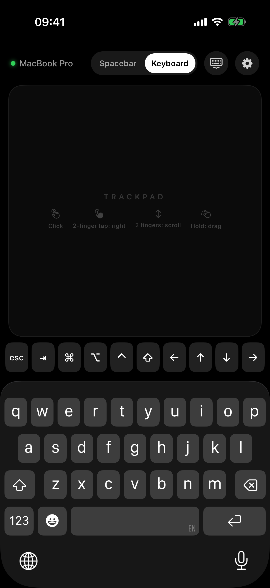
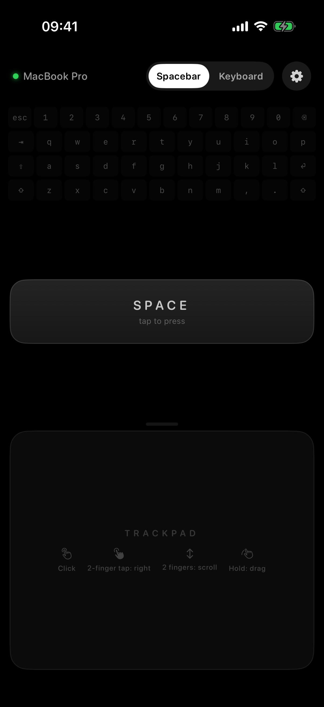
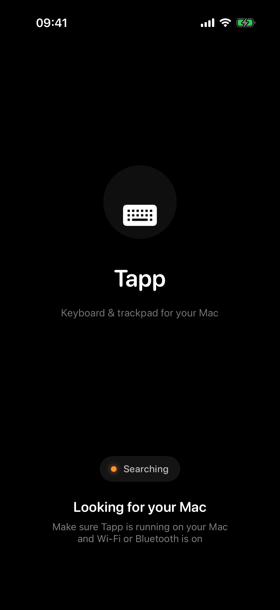

# Tapp

**Turn your iPhone into a keyboard and trackpad for your Mac.**

Tapp is a pair of native SwiftUI apps, one for iOS and one for macOS. Your iPhone connects to your Mac wirelessly and becomes a multi-touch trackpad with a keyboard. You can move the pointer, click, scroll, drag and type without touching the Mac. It's useful from the couch, during a presentation, or with a Mac hooked up to a TV.

<p align="center">
  
  &nbsp;&nbsp;
  
  &nbsp;&nbsp;
  
</p>

<p align="center"><sub>Keyboard mode · Spacebar mode · Connecting</sub></p>

---

## Features

### 🖱️ Multi-touch trackpad
The gestures are the same as on a Mac trackpad:

| Gesture | Action |
|---|---|
| Move 1 finger | Move the pointer (with acceleration) |
| Tap | Left click (tap twice quickly to double-click) |
| **Two-finger tap** | **Right click** |
| **Two-finger drag** | **Scroll** vertically and horizontally, with inertia |
| Press and hold, then move | Click and drag (select text, move windows and files) |

Every gesture gives haptic feedback. In Settings (⚙️) you can change the pointer and scroll speed and turn natural scrolling on or off.

### ⌨️ Keyboard mode
Keyboard mode uses the **iPhone's own system keyboard**, so you get full-size keys, accents, emoji and dictation. Text arrives on the Mac exactly as you typed it, whatever keyboard layout the Mac uses. A shortcut bar above the keyboard adds the keys the iPhone keyboard doesn't have:

- `esc`, `⇥` (tab) and the arrow keys `← ↑ ↓ →` (hold an arrow to repeat it)
- the modifiers `⌘ ⌥ ⌃ ⇧`: tap a modifier, then a key. For example, `⌘` then `c` copies, `⌘` then `⇥` switches apps, and `⌥` then `⌫` deletes a word

The ⌨️ button at the top hides the keyboard and gives the whole screen to the trackpad.

### ␣ Spacebar mode
A giant space bar next to the trackpad, for pausing videos, moving through slides or playing games.

### 💻 Mac companion
The Mac app runs in the menu bar and accepts the iPhone's connection automatically. It turns the commands it receives into real keyboard and mouse events, and it supports multiple displays.

---

## How it works

```
┌──────────────┐   MultipeerConnectivity    ┌──────────────────┐
│   iPhone     │  (Wi-Fi / Bluetooth / P2P) │       Mac        │
│              │ ─────────────────────────▶ │                  │
│ touch, keys  │   JSON packets             │ CGEvent → macOS  │
└──────────────┘                            └──────────────────┘
```

1. **Discovery and connection.** The Mac app advertises itself with **MultipeerConnectivity** (service `tapp-remote`). The iPhone finds it and connects on its own over Wi-Fi, Bluetooth or peer-to-peer Wi-Fi. There's nothing to configure.
2. **Protocol.** Every action (movement, click, scroll, key, text) is sent as a small JSON `TappPacket`, defined in [`TappCore.swift`](Tapp/Tapp/TappCore.swift). Movement and scroll packets are sent *unreliably* to keep latency as low as possible. Clicks and keys are sent *reliably*, so none are lost and they arrive in order.
3. **Event injection on the Mac.** [`EventInjector`](Tapp/Tapp/TappMacOS/Services/EventInjector.swift) creates system `CGEvent`s: mouse movement, clicks with the correct click state (so double-clicks work), continuous pixel scrolling like a real trackpad, and Unicode text. macOS requires the **Accessibility** permission for this.
4. **Reconnection.** If the connection drops, the iPhone reconnects on its own. The screen stays on while the app is open.

### Project layout

```
Tapp/Tapp/
├── TappApp.swift              # Single @main entry point for iOS and macOS
├── TappCore.swift             # Shared wire protocol + Mac key code table
├── TappIOS/
│   ├── Managers/              # ConnectionManager (MultipeerConnectivity), InputSender
│   └── Views/
│       ├── TrackpadView.swift     # UIKit multi-touch trackpad (gestures, scroll inertia)
│       ├── KeyboardView.swift     # System keyboard capture + shortcut bar
│       ├── SpacebarModeView.swift
│       ├── ControllerView.swift   # Layout, mode picker, settings
│       └── ConnectionView.swift
└── TappMacOS/
    ├── Services/              # NetworkServer, EventInjector, PermissionManager
    └── *View.swift            # Status window + menu bar extra
```

---

## Getting started

**Requirements:** Xcode 26 or later, macOS 26 or later, iOS 26 or later, and an Apple ID (a free one is enough) to sign the app.

1. Clone the repo and open `Tapp/Tapp.xcodeproj`.
2. Under **Signing & Capabilities**, pick your *Team*. Change the *Bundle Identifier* if Xcode asks you to.
3. **Mac:** choose *My Mac* as the run destination and press ▶︎. On first launch, macOS asks for the **Accessibility** permission. Open *System Settings → Privacy & Security → Accessibility* and turn on **Tapp**.
4. **iPhone:** plug in your iPhone, choose it as the run destination and press ▶︎. When the app asks for **Local Network** access, allow it.
5. Open Tapp on the iPhone. It finds your Mac and connects on its own. 🎉

> **Note:** the Mac target has App Sandbox turned off (`ENABLE_APP_SANDBOX = NO`). This is required: a sandboxed app can't generate system-wide input events.

### Troubleshooting

- **The iPhone can't find the Mac:** make sure Tapp is running on the Mac (look for the ⌨️ icon in the menu bar), that the iPhone has *Local Network* access (Settings → Privacy & Security → Local Network), and that Wi-Fi or Bluetooth is on on both devices.
- **The pointer moves but clicks and keys do nothing:** the Accessibility permission is missing. macOS may ask for it again after every new build. In *Accessibility*, remove Tapp with **–**, add it back, and relaunch the app.

---

## Development

To see the iOS interface in the Simulator without a Mac connected, launch a Debug build with the `-TappDemo` argument. The app then behaves as if it were already connected. That's how the screenshots above were taken.

```bash
xcrun simctl launch booted <bundle-id> -TappDemo
```

---

## License

Released under the [MIT License](LICENSE).
